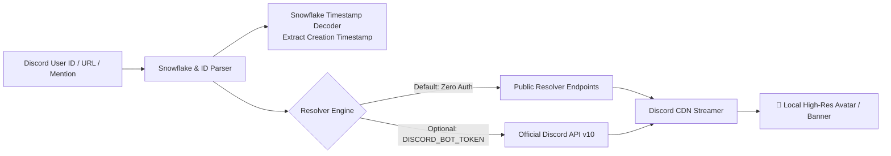

<p align="center"><a href="https://kitsunetechnologies.org/work"></a></p>

# Profile Fetch (discord-pfp)

> Fast, dependency-free Python CLI tool to resolve and download Discord avatars, banners, and account creation dates at up to 4096px resolution. Zero tokens required by default.

<p align="center">
  <a href="https://github.com/KitsuneTech1/discord-pfp/releases"></a>
  <a href="https://github.com/KitsuneTech1/discord-pfp/actions/workflows/ci.yml"></a>
  <a href="LICENSE"></a>
  <a href="https://www.python.org/downloads/"></a>
  <a href="discord_pfp.py"></a>
  <a href="discord_pfp.py"></a>
</p>

<p align="center">
  <a href="https://github.com/KitsuneTech1/discord-pfp/releases/latest"><strong>📦 Download Latest Release ZIP</strong></a> •
  <a href="#-quick-start-noob-friendly"><strong>⚡ Quick Start Guide</strong></a> •
  <a href="#-cli-reference"><strong>📖 CLI Reference</strong></a>
</p>

---

```
$ python discord_pfp.py 80351110224678912 --banner
user:        Wumpus (@wumpus, 80351110224678912)
created:     2015-11-20T14:29:00.000Z  (4001 days old)
avatar:      https://cdn.discordapp.com/avatars/80351110224678912/a_1234.gif?size=4096
banner:      https://cdn.discordapp.com/banners/80351110224678912/b_5678.png?size=4096
```

---

## Architecture & Resolution Pipeline



---

## Features

- **Zero Dependencies**: Pure Python standard library (`urllib`, `json`, `datetime`, `argparse`). No `pip install` required.
- **No Token Required**: Resolves users without requiring a registered Discord bot token or developer account.
- **Full Resolution (Up to 4096px)**: Downloads uncompressed full-fidelity assets with animated `.gif` support.
- **Snowflake Date Calculation**: Decodes exact account registration timestamps directly from the 64-bit Discord snowflake ID.
- **Flexible Inputs**: Accepts raw numeric IDs (`80351110224678912`), profile URLs (`https://discord.com/users/...`), or mentions (`<@80351110224678912>`).

---

## 🚀 Quick Start (Noob-Friendly)

### 1. Download & Launch
1. Download [**Profile Fetch ZIP**](https://github.com/KitsuneTech1/discord-pfp/releases/latest) and extract it.
2. Double-click **`start.bat`** (Windows) or run `./start.sh` (macOS/Linux) to test your environment and view CLI options.

### 2. Lookup Any User
```bash
python discord_pfp.py 80351110224678912
```

### 3. Download Avatar to Disk
```bash
# Save avatar image directly to disk
python discord_pfp.py 80351110224678912 --save

# Save both avatar and banner
python discord_pfp.py 80351110224678912 --banner --save
```

---

## 📖 CLI Reference

```
usage: discord_pfp.py [-h] [--banner] [--save] [--size {128,256,512,1024,2048,4096}]
                      [--json] [--out-dir DIR]
                      user_id
```

| Flag | Description |
|---|---|
| `user_id` | Discord User ID (or mention / profile URL) |
| `--banner` | Also retrieve user's banner URL and asset |
| `--save` | Download the asset file(s) to disk |
| `--size` | Set asset dimension: 128, 256, 512, 1024, 2048, or 4096 (default) |
| `--json` | Output full metadata in machine-readable JSON format |
| `--out-dir` | Directory to save downloaded image files (default: current directory) |

---

## 🧪 Testing & Verification

Run the built-in offline test suite:

```bash
python -m unittest discover -s tests
```

Tests cover:
- Discord snowflake timestamp decoding accuracy.
- URL and mention regex extraction.
- Animated vs static asset URL resolution.
- Error handling for invalid IDs or unreachable endpoints.

---

## License

MIT. Copyright (c) 2026 Kitsune Technologies LLC. Full text in [LICENSE](LICENSE).

<p align="center"><sub>Part of <b>Buildtober 2026</b>: 31 open source projects in 31 days. Built by <a href="https://kitsunetechnologies.org/work">Kitsune Technologies</a>. More at <a href="https://github.com/KitsuneTech1">github.com/KitsuneTech1</a>.</sub></p>
